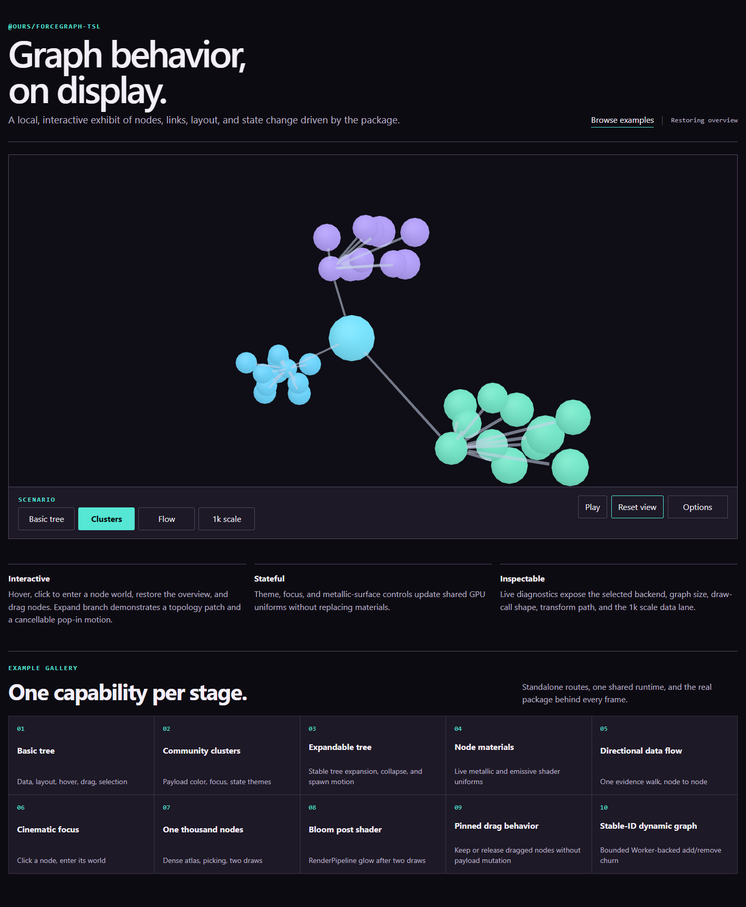

# ForceGraph TSL

Deterministic graph layout and batched Three.js rendering for applications that
own their scene. The package is `@ours/forcegraph-tsl`; this source snapshot is
an MIT-licensed alpha.

- Run graph state, patches, snapshots, and seeded 2D/3D layout in Node without a DOM or Three dependency.
- Inject the application's exact Three.js and TSL modules for a managed canvas or an existing scene.
- Render shared node/link layers, with selection, dragging, metallic surfaces, and directional flow.
- Keep camera controls, labels, post-processing, storage, and application policy with the host.

[Explore the showcase](examples/showcase/) · [Corpus Atlas](examples/corpus/) · [API and ownership](docs/API.md)



## Run the examples

Use Node.js 22.13 or newer and the pinned `pnpm` version in
[package.json](package.json). The package runtime declares Node `>=20.19.0`;
the contributor tools have their own Node requirements.

```sh
pnpm install --frozen-lockfile --ignore-scripts
pnpm run showcase
```

Open the localhost URLs printed by the server. Ctrl+C stops it. Dependency
installation is a separate, explicit step; running a demo never installs packages.

For the app menu on Windows, run `scripts/app.ps1` in Windows PowerShell 5.1
or PowerShell 7. `node run.mjs` and `run.cmd` are convenience entry points.
The menu offers setup, showcase, headless example, build, and checks. Commands
can also be selected directly:

```sh
node run.mjs --task run
node run.mjs --task test
node run.mjs --task setup --dry-run
```

PowerShell also accepts `./scripts/app.ps1 -Task run` and
`./scripts/app.ps1 -Task test`. Stable task IDs such as `forcegraph.check`
work alongside the short aliases. The menu checks for the pinned pnpm version
and fails if it is missing; it never provisions that toolchain. `PROJECT_PNPM`
can point to an already installed `pnpm.cjs` when needed.

The single portable command registry lives in [project.tasks.json](project.tasks.json).
The menu dispatches those product commands. `--dry-run` prints the selected
commands without executing them.

## Try the headless API

After building, `node examples/headless.mjs` runs a complete Node example:

```js
import { createHeadlessForceGraph } from '@ours/forcegraph-tsl/headless';

const graph = createHeadlessForceGraph({
  layout: { seed: 1337, autoStart: false, dimensions: 3 }
});

graph.setData({
  nodes: [{ id: 'root' }, { id: 'child' }],
  links: [{ id: 'root-child', source: 'root', target: 'child' }]
});
graph.stepLayout(32);
console.log(graph.graph.getNodePosition('child'));
graph.dispose();
```

The headless declaration graph uses `ES2022` without DOM, browser Worker, or
Three types. `./labels` and `./camera` are also independent pure planners.

## Add a managed canvas

Install Three r185 in the consumer. The rendered entry points use an optional
`three` peer; the headless entry does not need it. With a canvas in your page:

```js
import * as THREE from 'three/webgpu';
import * as TSL from 'three/tsl';
import { createForceGraph3D, createThreePlatform } from '@ours/forcegraph-tsl';

const canvas = document.querySelector('canvas');
if (!canvas) throw new Error('Add a canvas to the page.');

const graph = await createForceGraph3D({
  platform: createThreePlatform({ THREE, TSL }),
  host: { mode: 'managed', canvas },
  layout: { backend: 'worker', seed: 1337 },
  renderer: { backend: 'auto', frameLoop: 'demand' }
});

await graph.setDataAsync({
  nodes: [{ id: 'root' }, { id: 'child' }],
  links: [{ id: 'root-child', source: 'root', target: 'child' }]
});

// Call graph.dispose() when the canvas is removed.
```

For an existing renderer/scene/camera, use the embedded recipe in
[API.md](docs/API.md). Embedded resources remain borrowed.

## Public examples

The [gallery](examples/showcase/) demonstrates basic layout, communities,
immutable expansion, materials, flow, camera travel, a 1,000-node scene,
host-owned Bloom, pin/release behavior, and Worker-backed dynamic patches.
[Corpus Atlas](examples/corpus/) explores a checked-in synthetic metadata
manifest through search, focus, and camera replay. Both examples retain the
Vector Relay presentation.

The graph is a reusable math/layout/rendering library. Retrieval, language
contracts, document ingestion, and knowledge-exploration application behavior
belong to the separate RAG Method project.

## Build, test, and package

```sh
pnpm run typecheck
pnpm run check
npm run pack:release -- --output ../forcegraph-package
```

Install the resulting `.tgz` in a consumer with npm or pnpm. The package
contains ESM output, declarations, source maps and their TypeScript sources,
the project license, and dependency notices. `pack:release` requires a current
reviewed `PUBLIC_MANIFEST.json`, stages the actual npm file inventory, replaces
only the staged README with the consumer guide, and writes a fingerprint-bound
archive receipt beside the output. Run `pnpm run build` first. Output stays
outside the source tree and existing archives are preserved. Registry
publication remains a separate release action.

The checks cover public API/ownership behavior and bounded Node example/server
tests. GPU and visual behavior require a real browser; see
[verification](docs/VERIFICATION.md). The source fingerprint and exact inventory
are recorded in `PUBLIC_MANIFEST.json` for the reviewed snapshot.

See [CONTRIBUTING.md](CONTRIBUTING.md), [architecture](docs/ARCHITECTURE.md), and
[third-party notices](THIRD_PARTY_NOTICES.md). Redistribution follows
[LICENSE](LICENSE).
