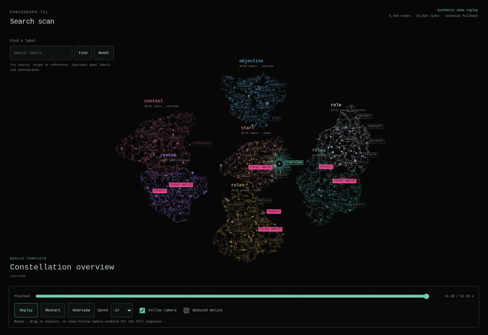

# Search scan

A host-owned animation prefab and working showcase example inspired by a short
recording of a scanner moving through colored word clusters. It combines stable
graph geometry, an absolute-time replay, progressively revealed labels, a small
teal scanner with a pink core, and camera handoffs between clusters.

This belongs in ForceGraph TSL because the reusable work is graph presentation.
The example includes a local text search to exercise replay with real matches;
it does not perform document retrieval or model inference.



Browser capture using the explicitly labelled Canvas fallback.

## Run

From the repository root:

```sh
pnpm install --frozen-lockfile --ignore-scripts
pnpm run showcase
```

Open the printed showcase URL and select **Search scan**. The direct route under
the same server origin is `/showcase/examples/search-scan/index.html`.

The normal route selects Three's WebGPU/WebGL2 renderer when a graphics context
is available. Otherwise it uses a clearly labelled **Canvas2D fallback**, backed
by the package's real headless graph state and the same presentation timeline,
camera planners, label planner, and Three scene geometry. This fallback is
specific to this example; it is not a new core renderer or a public package API.
Its radial halo approximates the TSL material. Canvas results do not establish
GPU rendering or GPU performance.

If graphics startup, a reported shader error, or device loss fails after the
capability probe, the host restarts this page once in **Compatibility mode**.
That restart obtains a fresh canvas: a canvas already used by a GPU renderer
cannot be reused for a 2D context. The reference playhead and pause state are
preserved when available; a local search is reset by the page restart. A failure
in Canvas mode remains visible and cannot trigger another automatic retry.
The **Compatibility mode** and **Automatic graphics** links remain available
even if the renderer stops. Module-load failures also produce a visible message.

Useful query parameters:

| Parameter | Effect |
| --- | --- |
| `?paused=1&t=3500` | Deterministic rules-cluster view at 3.50 seconds. |
| `?paused=1&t=11100` | Completed constellation overview. |
| `?presentation=1` | Hide example controls and captions for a clean stage. Combine with `paused` and `t` for captures. |
| `?motion=reduced` | Stationary overview; disables playback. |
| `?backend=webgl2` | Try WebGL2 directly; a failure restarts in labelled Compatibility mode. |
| `?backend=canvas2d` | Exercise the explicit Canvas fallback. |

## Behavior

The default fixture contains seven irregular shallow 3D clusters, 6,440 seeded
nodes, 15,029 short local edges, and 140 word labels. Most points are decorative members
of this synthetic graph; they are not documents. The camera visits **roles →
rules → review → start → overview** in 11.10 seconds, approximately following
the recording's sequence and pacing. The text and graph positions are synthetic.

The graph stays pinned. Motion comes from the scanner, bending filaments,
transition strands, camera, and progressive label visibility. Seeking backward
reconstructs the earlier state from elapsed time without accumulating animation
history. It does not depend on completing previous animation frames.

- **Find:** case-insensitive substring matching over label text and the fixture's
  annotations. Results are available immediately. The animation replays them
  in fixture order. `source`, `scope`, and `reference` are useful queries.
- **No matches:** retain the graph, show an empty-result message and overview,
  and disable playback. Reset restores the reference sequence.
- **Pause / Play / Replay:** pause at the current playhead; play resumes it;
  replay restarts after completion. The playhead slider always pauses to seek.
- **Restart:** reset the active sequence and re-enable camera following.
- **Overview:** show the whole graph while preserving the playhead.
- **Manual navigation:** drag to orbit and scroll/pinch to zoom. Navigation
  disables Follow camera; checking it again rejoins the replay's camera.
- **Reduced motion:** show the stationary overview without waving, pulsing, or
  automatic camera movement. OS preference and the URL option take priority
  over the local control. Changing the OS preference is observed throughout the
  page lifetime.
- **Keyboard:** focus the canvas; Space toggles playback, left/right arrows
  seek by 300 ms, and Home shows the overview.

The host uses one demand-driven animation loop. Playback requests the next
frame; paused, completed, hidden, and reduced-motion views stop continuous
rendering. Resizing, camera input, and controls request a new frame as needed.
The host dims surrounding groups at replay boundaries using existing node flags;
it does not replace node or link materials on every animation frame.

## Files and ownership

| File | Responsibility |
| --- | --- |
| [search-scan-model.js](search-scan-model.js) | Frozen seeded fixture, local edges, ordered steps, and bounds. |
| [search-scan-timeline.js](search-scan-timeline.js) | Pure time sampling; no DOM, renderer, timers, or retrieval. |
| [search-scan-prefab.js](search-scan-prefab.js) | Scanner scene objects, camera poses, transition strands, and bounded DOM labels. |
| [search-scan.js](search-scan.js) | Host initialization, search, playback controls, one render loop, and teardown. |
| [search-scan-boot.js](search-scan-boot.js) | Load the example, preserve graphics-mode links, and show module-load failures. |
| [search-scan-canvas.js](search-scan-canvas.js) | Explicit example-only fallback using the headless graph and Canvas2D. |
| [search-scan-graphics.js](search-scan-graphics.js) | Observe renderer-reported errors and device loss; restore borrowed hooks during cleanup. |
| [search-scan.css](search-scan.css) | Reference-inspired stage and existing Vector Relay controls. |

The prefab borrows `THREE`, `TSL`, `graph`, `scene`, `camera`, and `labelLayer`.
It owns only its scanner/strand objects and label subtree. `dispose()` is
idempotent and removes/disposes those resources. The host still owns and
disposes graph, renderer, controls, observers, listeners, and its animation loop.

The example adds no dependency, package export, retrieval policy, or global
renderer patch. Examples remain outside the current npm package inventory.
Consumers may review and adapt this source prefab; it is not yet an importable
package subpath or a published RAG integration.

## Reuse the prefab

Use the same Three and TSL instances as the host. Set graph data before creating
the prefab; the presentation model must reference accepted graph nodes.

```js
import { createSearchScanPrefab } from './search-scan-prefab.js';
import { buildSearchScanFixture } from './search-scan-model.js';

const model = buildSearchScanFixture();
graph.setData({ nodes: model.nodes, links: model.links });

const scan = createSearchScanPrefab({
  THREE, TSL, graph, scene, camera, labelLayer, model,
  travelMs: 300,
  overviewMs: 1500
});
scan.resize(canvas.clientWidth, canvas.clientHeight);

// Inside the host's existing loop. elapsedMs is an absolute playhead.
scan.render(elapsedMs, {
  followCamera: true,
  reducedMotion: false,
  overview: false
});
graph.update(deltaSeconds);
graph.render();                 // Sync the embedded graph's layers.
renderer.render(scene, camera); // Draw the borrowed scene once.

// On teardown, before disposing the host graph and renderer:
scan.dispose();
```

`scan.render()` returns the sampled timeline state. `scan.durationMs` reports
the active sequence length. `scan.setSequence(steps, { resultNodeIds })` validates
the replacement before accepting it and returns its duration. The caller resets
or clamps its playhead. `scan.inspect()` exposes bounded diagnostics for the
example; these are not core package diagnostics.

### Presentation model contract

Use immutable data. Presentation IDs are **nonempty strings**, even though the
underlying graph API also supports numeric IDs. Do not silently convert numeric
IDs to strings: graph IDs `1` and `"1"` are distinct. A consumer using numeric IDs
must explicitly map its graph and presentation consistently.

- `groups`: unique `id`, `label`, integer RGB `color`, finite `center: {x,y,z}`,
  positive `radius`, and ordered `nodeIds` for its word labels.
- `nodes`: unique graph `id`, finite `initialPosition`, and data containing
  `groupId`, RGB `color`, and positive `radius`. Word nodes have `label`; an
  optional `annotation` participates in the example text match. Accepted graph positions must exist.
- `links`: valid `source` and `target` references. Cross-group links, when
  supplied, support up to 16 curved group-pair bridges. The demonstration
  fixture itself uses local links; intergroup motion uses transition strands.
- `steps`: ordered `{ groupId, nodeIds, durationMs }` entries. Every node must
  belong to the declared group. Adjacent or separated visits to the same group
  are permitted and never sorted or merged across intervening groups.
- `resultNodeIds`: accepted node IDs to emphasize as results.
- `bounds`: finite graph framing bounds, used as a framing fallback.

The timeline bounds input size and total replay duration. The prefab permits at
most 512 word labels; label visibility uses a viewport/collision budget of 65 on
narrow screens and 110 on wider screens. A group becomes complete only after its
last scheduled visit. Group progress describes **label presentation**, not
retrieval progress or an engine's internal reasoning.

## RAG Method integration seam

RAG Method remains the authority for search, ranking, citations, context
selection, and source identity. At the inspected RAG revision
`c54fac30d53a63dbf4448163830ea91195db87fb`, the browser demo already has an
accepted-result replay hook in
[demo/main.ts](https://github.com/Shoozes/rag-method-alpha/blob/c54fac30d53a63dbf4448163830ea91195db87fb/modules/browser-rag-ts/demo/main.ts).
That hook follows search/context validation and graph refresh, and uses request
generation checks to cancel superseded presentation.

For that consumer, adapt accepted ordered record/source IDs through its existing
graph identity mapping, then create contiguous group steps **without changing
the accepted result order**:

```js
const steps = [];
for (const graphId of acceptedGraphIds) {
  const groupId = groupFor(graphId);
  let step = steps.at(-1);
  if (!step || step.groupId !== groupId) {
    step = { groupId, nodeIds: [], durationMs: 0 };
    steps.push(step);
  }
  step.nodeIds.push(graphId);
  step.durationMs = Math.max(900, step.nodeIds.length * 220);
}
scan.setSequence(steps, { resultNodeIds: acceptedGraphIds });
```

Keep the consumer's request-generation/corpus guards. Deliver results and
context independently of the replay, cancel the old replay when a new accepted
request replaces it, and honor reduced motion. Do not feed decorative fixture
nodes into retrieval or wait for this animation to assemble an answer. No RAG
repository changes are included in this example.

## Verification

The [video-reference workflow](../../../../docs/VIDEO_REFERENCE_WORKFLOW.md)
records the contact-sheet recipe, source timestamp mapping, temporal contract,
comparison process, and lessons for a future Clone Jutsu review gate.

Run `pnpm run check` for the repository's TypeScript, product, example, tooling,
and documentation checks. Targeted tests are in
[search-scan.test.mjs](../../../../tests/browser/search-scan.test.mjs) and
[search-scan-prefab.test.mjs](../../../../tests/browser/search-scan-prefab.test.mjs).
They exercise timeline determinism, membership, replay boundaries, repeated
groups, backward seeking, construction rollback, and resource ownership.

Despite their directory name, these tests run in Node. Browser-rendered
appearance, actual interaction, and backend verification are recorded separately
in the repository's `design-qa.md`. A successful Node check is not GPU evidence.
